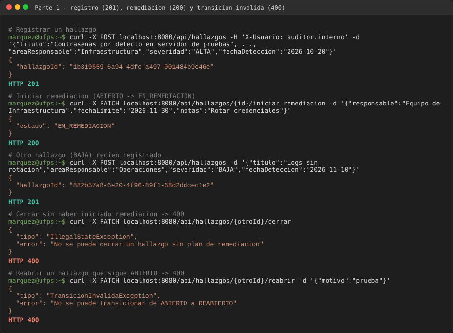
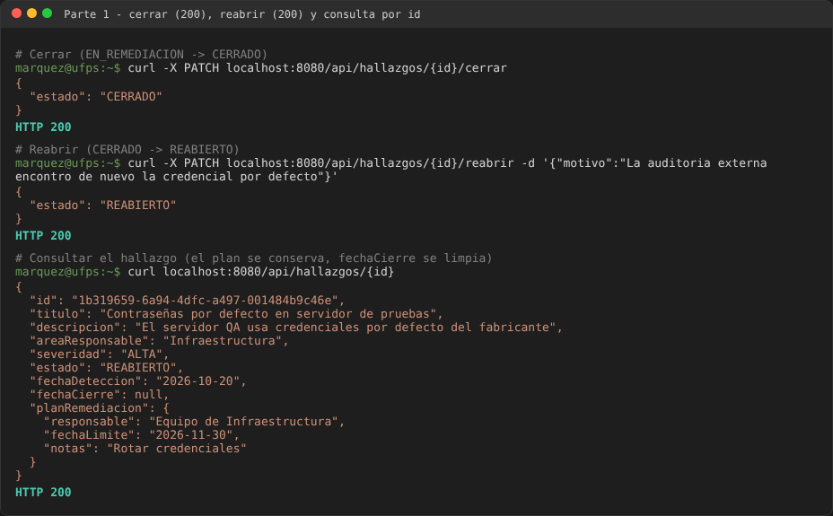
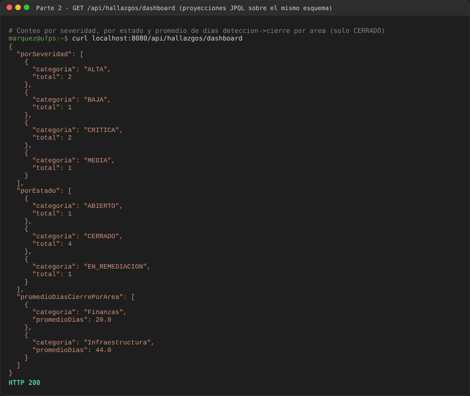
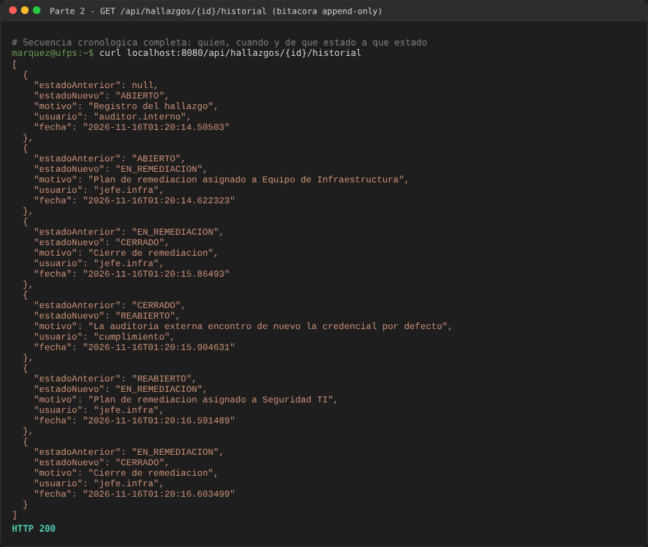
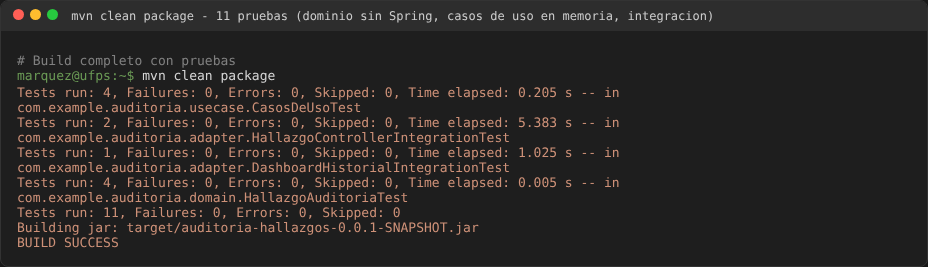

# Post-contenido — Unidad 8: Patrones Arquitectónicos II

**Universidad Francisco de Paula Santander — Ingeniería de Sistemas**
**Curso:** Patrones de Diseño de Software (1156701-A)
**Estudiante:** Diego Armando Márquez Rigaud — **Código:** 1152115

## Descripción

Repositorio del post-contenido de la Unidad 8 de Patrones de Diseño de Software. Sistema de seguimiento
de hallazgos de auditoría interna implementado con **Clean Architecture** (Parte 1) y extendido con un
**dashboard agregado** y una **bitácora de trazabilidad** (Parte 2), sobre el mismo proyecto Spring Boot
(`auditoria-hallazgos`). La Parte 2 no adopta CQRS ni Event Sourcing completos: un análisis
costo-beneficio con los criterios de la guía concluyó que una extensión liviana resolvía ambos requisitos.

## Estructura de paquetes (cuatro círculos)

```
marquez-post1-u8-pd/
├── pom.xml
├── docs/capturas/
└── src/main/java/com/example/auditoria/
    ├── domain/                          ← ENTITIES (Java puro)
    │   ├── entity/HallazgoAuditoria.java          Aggregate Root con máquina de estados
    │   └── valueobject/ HallazgoId, Severidad, EstadoHallazgo, PlanRemediacion, TransicionInvalidaException
    ├── usecase/                         ← USE CASES (sin Spring)
    │   ├── *UseCase.java                          Registrar, IniciarRemediacion, Cerrar, Reabrir, Consultar,
    │   │                                          ObtenerDashboardAuditoria, ConsultarHistorial
    │   ├── port/                                  HallazgoRepositoryPort, HistorialAuditoriaPort, vistas (records)
    │   └── impl/                                  *Service.java (implementaciones)
    ├── adapter/                         ← INTERFACE ADAPTERS
    │   ├── in/web/                                HallazgoController, ManejadorErrores, dto/
    │   └── out/persistence/                       HallazgoJpaEntity, HallazgoRepositoryAdapter,
    │                                              HistorialCambioEstadoJpaEntity, HistorialAuditoriaAdapter
    ├── config/AuditoriaConfiguration.java  ← FRAMEWORKS & DRIVERS: wiring explícito + transacciones
    └── AuditoriaHallazgosApplication.java
```

Regla de dependencia: `adapter` y `config` → `usecase` → `domain`. Verificado con
`grep -r "org.springframework\|jakarta.persistence" src/main/java/com/example/auditoria/{domain,usecase}`
(sin resultados). `HallazgoAuditoriaTest` instancia y transiciona el agregado sin `@SpringBootTest`, y
`CasosDeUsoTest` prueba los casos de uso con dobles en memoria de los puertos.

## Parte 1 — Clean Architecture (Hallazgos de Auditoría)

- **Entities:** `HallazgoAuditoria` solo cambia de estado mediante `iniciarRemediacion`, `cerrar` y
  `reabrir`; cada método valida con `EstadoHallazgo.puedeTransicionarA` y devuelve el estado anterior.
  Ciclo válido: `ABIERTO → EN_REMEDIACION → CERRADO → REABIERTO → EN_REMEDIACION`.
- **Use Cases:** un caso de uso por intención de negocio, cada uno con su interfaz y su implementación;
  dependen del puerto `HallazgoRepositoryPort`, nunca de JPA. `ConsultarHallazgoUseCase` devuelve el
  agregado y el controller lo mapea a `HallazgoResponse`, para que `usecase/` no dependa de un DTO web.
- **Interface Adapters:** `HallazgoController` traduce HTTP ↔ casos de uso; `ManejadorErrores` convierte
  `TransicionInvalidaException`/`IllegalStateException` en 400 y `HallazgoNotFoundException` en 404;
  `HallazgoRepositoryAdapter` traduce campo a campo entre el agregado y `HallazgoJpaEntity`.
- **Frameworks & Drivers:** `AuditoriaConfiguration` registra cada caso de uso como `@Bean` y lo envuelve
  con `TransactionTemplate`, porque los casos de uso no pueden llevar `@Transactional` sin importar Spring.

Mejora respecto al esqueleto del enunciado: al leer de la base de datos, el adaptador usa
`HallazgoAuditoria.reconstituir(...)` en vez de volver a ejecutar las transiciones. Reproducir
`iniciarRemediacion → cerrar → reabrir` al cargar sobrescribía `fechaCierre` con la fecha de la lectura
(rompiendo el promedio del dashboard) y fallaba para un hallazgo `REABIERTO` que ya tenía plan.

| Método | Endpoint | Respuesta |
|---|---|---|
| POST | `/api/hallazgos` | 201 `{"hallazgoId": "<uuid>"}` / 400 |
| PATCH | `/api/hallazgos/{id}/iniciar-remediacion` | 200 / 400 (transición inválida) / 404 |
| PATCH | `/api/hallazgos/{id}/cerrar` | 200 / 400 (sin plan o transición inválida) |
| PATCH | `/api/hallazgos/{id}/reabrir` | 200 / 400 |
| GET | `/api/hallazgos`, `/api/hallazgos/{id}` | 200 / 404 |
| GET | `/api/hallazgos/dashboard` | 200 — Parte 2 |
| GET | `/api/hallazgos/{id}/historial` | 200 / 404 — Parte 2 |

Las operaciones de escritura aceptan la cabecera opcional `X-Usuario` (quién origina el cambio; en
producción vendría del token de autenticación). Si no se envía, se registra `anonimo`.

## Parte 2 — Análisis costo-beneficio de CQRS/Event Sourcing

**Escala y carga.** Es un sistema académico usado por un comité que se reúne una vez al mes y por unas
pocas personas que registran y actualizan hallazgos: decenas de escrituras al mes y unas cuantas
consultas del dashboard por reunión, sin usuarios concurrentes reales. No existe una asimetría
lecturas/escrituras de órdenes de magnitud que obligue a escalar por separado el lado de consulta (el
caso que la Sección 4.4 usa para justificar CQRS). Infraestructura separada costaría más de lo que ahorra.

**Complejidad de las consultas.** Los tres indicadores son `COUNT ... GROUP BY severidad`,
`COUNT ... GROUP BY estado` y `AVG(días entre detección y cierre) ... WHERE estado = CERRADO GROUP BY
área`. Son alcanzables con JPQL sobre el mismo esquema (`HallazgoJpaRepository`, interface projections) y
los resuelve el motor de base de datos en una consulta cada uno. No requieren otra tecnología, ni
desnormalización, ni un esquema de lectura: la "forma distinta" de las lecturas se resuelve con una
proyección, no con un segundo modelo.

**Consistencia.** El comité consulta el dashboard antes de cada reunión; lo esperable es que refleje el
estado **en el momento de la consulta**, como cualquier reporte bajo demanda. Con la extensión liviana es
incluso mejor que con CQRS completo: al leer el mismo esquema que escribe, la consistencia es inmediata,
mientras que un modelo de lectura proyectado de forma asíncrona introduciría consistencia eventual y
lógica de sincronización que nadie pidió.

**Naturaleza de la trazabilidad.** Cumplimiento pide reconstruir **la secuencia** de cambios de estado
(quién, cuándo, de qué estado a qué estado) sin alteraciones retroactivas. No pide reconstruir el
**estado** del agregado reproduciendo eventos, ni consultas temporales ("¿cómo estaba el hallazgo el día
X?") sobre todos los campos, ni alimentar proyecciones futuras. Basta una bitácora cronológica
append-only que coexista con el estado actual. Event Sourcing convertiría la bitácora en fuente de verdad
y obligaría a rehacer un agregado que ya funciona.

**Señales de sobre-ingeniería (Sección 7.2).** No hay un experto de negocio disponible para modelar
eventos (ni un lenguaje de eventos acordado con Cumplimiento); el equipo es una sola persona sin
experiencia previa con Event Sourcing (versionado de eventos, snapshots, upcasting, reconstrucción de
proyecciones); y el costo de mantener dos modelos (escritura + lectura, o event store + proyecciones) no es
proporcional a tres consultas agregadas y una tabla de historial. Las tres señales están presentes.

**Conclusión.** **No se justifican CQRS ni Event Sourcing completos en este momento.** Se implementó la
extensión liviana: `HallazgoRepositoryPort` y `HallazgoJpaRepository` (el mismo puerto y el mismo
repositorio) ganan tres consultas agregadas, y se añadió `HistorialAuditoriaPort` con una tabla
`historial_cambios_estado` escrita en la misma transacción que cada transición. Sí hay una separación
CQRS "ligera" a nivel de casos de uso (comandos que cambian estado vs. consultas que solo leen), pero sin
stacks, modelos ni bases de datos separados.

Cómo se garantiza que la bitácora no se altere: `HistorialCambioEstadoJpaEntity` está marcada
`@Immutable` (Hibernate ignora cualquier UPDATE), todas sus columnas son `updatable = false`, no tiene
setters, y `HistorialCambioEstadoJpaRepository` extiende `Repository` (no `JpaRepository`), así que solo
expone `save` y consultas: no existe ningún método `delete*`. Una transición rechazada no inserta nada
(probado en `DashboardHistorialIntegrationTest`).

## Decisiones de diseño

1. **Severidad como enum simple vs. EstadoHallazgo como enum con máquina de estados.** `EstadoHallazgo`
   protege una regla de negocio real: qué transiciones son válidas. Si esa regla viviera en los servicios,
   cada caso de uso tendría que repetir los `if` y bastaría olvidar uno para permitir cerrar un hallazgo
   que nunca estuvo en remediación. Al ponerla en el propio enum (`puedeTransicionarA`), el agregado la
   aplica en un solo lugar (`transicionar`). `Severidad`, en cambio, es solo una clasificación: no hay una
   severidad "válida" o "inválida" según el momento, ni transiciones entre severidades. Darle
   comportamiento sería inventar reglas (complejidad especulativa). Si en el futuro apareciera una regla
   real (por ejemplo, plazo máximo de remediación según severidad: CRÍTICA 7 días, BAJA 90), entonces sí
   convendría un método `plazoMaximo()` en `Severidad`.
2. **PlanRemediacion como Value Object embebido vs. agregado separado.** El criterio de la Sección 3.3 es
   el **límite de consistencia transaccional**: lo que debe ser consistente en todo momento pertenece al
   mismo agregado. La invariante "no se pasa a EN_REMEDIACION sin un plan válido y no se cierra sin plan"
   involucra al hallazgo y a su plan a la vez. Si el plan fuera un agregado con repositorio propio,
   habría dos transacciones (guardar plan, cambiar estado) y una ventana en la que un hallazgo podría
   quedar EN_REMEDIACION sin plan, o un plan huérfano. Además, el plan no tiene identidad ni ciclo de vida
   propios: se reemplaza completo (al reabrir y remediar de nuevo se asigna un plan nuevo), lo cual es la
   definición de un Value Object inmutable. Se persiste como columnas `plan_*` en la misma fila.
3. **CQRS/Event Sourcing completos vs. extensión liviana del repositorio existente.** Ver el análisis
   anterior: con la escala real (sin concurrencia), consultas resolubles con `GROUP BY` sobre el mismo
   esquema y necesidad de consistencia inmediata en el reporte, los criterios de las Secciones 4.4 y 7 no
   se cumplen. Se extendió el mismo puerto con proyecciones; no hay repositorio ni modelo de lectura
   separado. Se reconsideraría si (a) el dashboard pasara a ser consultado por cientos de usuarios o
   embebido en otros sistemas con carga alta, (b) aparecieran indicadores que exijan cruzar historiales
   completos con ventanas temporales que una consulta relacional no resuelva con buen rendimiento, o (c) se
   necesitaran varias proyecciones distintas alimentadas por los mismos cambios.
4. **Bitácora simple (HistorialCambioEstado) vs. Event Store completo.** Las señales de sobre-ingeniería
   de la Sección 7.2 están todas presentes: sin experto de negocio para modelar eventos, equipo de una
   persona sin experiencia en Event Sourcing y costo desproporcionado (event store, replay, snapshots,
   versionado de eventos) frente a un requisito que solo pide mostrar la secuencia de cambios. La
   bitácora es append-only, se escribe en la **misma transacción** que la transición (los casos de uso se
   envuelven con `TransactionTemplate` en `AuditoriaConfiguration`) y **no** se usa para reconstruir el
   estado: `HallazgoJpaEntity` sigue siendo la única fuente del estado actual. Además de lo pedido se
   registra el alta del hallazgo (`estadoAnterior = null`) y el usuario que origina cada cambio, porque el
   requisito de Cumplimiento menciona explícitamente "quién lo originó".

## Cómo ejecutar

Requisitos: JDK 17+ y Maven 3.8+.

```bash
mvn clean package        # compila y ejecuta las 11 pruebas
mvn spring-boot:run      # http://localhost:8080 (consola H2 en /h2-console, JDBC jdbc:h2:mem:auditoria_db)
```

```bash
curl -X POST localhost:8080/api/hallazgos -H "Content-Type: application/json" -H "X-Usuario: auditor.interno" \
     -d '{"titulo":"Contraseñas por defecto en servidor de pruebas","descripcion":"El servidor QA usa credenciales por defecto del fabricante","areaResponsable":"Infraestructura","severidad":"ALTA","fechaDeteccion":"2026-10-20"}'
curl -X PATCH localhost:8080/api/hallazgos/{id}/iniciar-remediacion -H "Content-Type: application/json" \
     -d '{"responsable":"Equipo de Infraestructura","fechaLimite":"2026-11-30","notas":"Rotar credenciales"}'
curl -X PATCH localhost:8080/api/hallazgos/{id}/cerrar
curl -X PATCH localhost:8080/api/hallazgos/{id}/reabrir -H "Content-Type: application/json" -d '{"motivo":"Reaparece"}'
curl localhost:8080/api/hallazgos/dashboard
curl localhost:8080/api/hallazgos/{id}/historial
```

## Capturas de los endpoints probados

**Parte 1 — registro (201), iniciar remediación (200), cerrar/reabrir inválidos (400)**


**Parte 1 — cerrar, reabrir y consultar**


**Parte 2 — dashboard consolidado.** Infraestructura: (27 + 61) / 2 = 44 días; Finanzas: (30 + 10) / 2 = 20 días.


**Parte 2 — historial cronológico de un hallazgo cerrado, reabierto y vuelto a cerrar**


**Build y pruebas**


## Herramientas utilizadas

- Java 17, Spring Boot 3.3, Spring Web, Spring Data JPA (interface projections, HQL), Bean Validation, H2
- JUnit 5, AssertJ, MockMvc
- Apache Maven, curl, Git, GitHub

## Conclusiones

Clean Architecture obligó a que cada regla viviera en el círculo correcto: la máquina de estados en el
dominio, la orquestación en los casos de uso y las transacciones en la configuración, lo que permitió
probar el núcleo sin Spring. La Parte 2 mostró que los requisitos que "suenan" a CQRS y Event Sourcing no
siempre los justifican: tres consultas `GROUP BY` y una tabla append-only en la misma transacción
resolvieron el dashboard y la trazabilidad con consistencia inmediata y una fracción del costo. Lo más
importante fue separar "necesito ver la historia" (bitácora) de "necesito que la historia sea la fuente de
verdad" (Event Sourcing). Reconsideraría CQRS si el dashboard tuviera carga alta o varias proyecciones
distintas, y Event Sourcing si Cumplimiento exigiera reconstruir el estado completo de un hallazgo en una
fecha arbitraria o si otros sistemas necesitaran suscribirse a los cambios.
